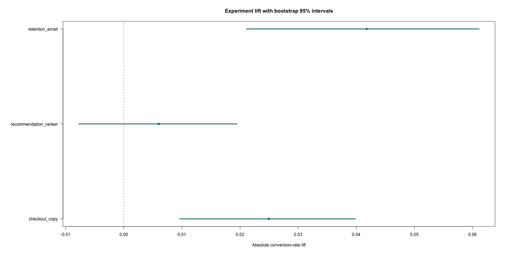

# Experiment Reliability Analyzer

A reproducible R analysis of randomized product experiments, built to distinguish real treatment effects from noisy dashboards.

## How It Works

- Generates three seeded A/B experiments with device, channel, return status, conversion, and revenue outcomes.
- Checks sample-ratio mismatch before interpreting experiment results.
- Estimates absolute lift, relative lift, and non-parametric bootstrap confidence intervals.
- Controls the false-discovery rate across experiments with Benjamini-Hochberg correction.
- Fits an adjusted logistic model and calculates future sample requirements at 80% power.
- Produces a decision table and forest plot with an explicit `ship treatment` threshold.
- Uses base R for the complete pipeline; only rendering the optional R Markdown report needs `rmarkdown` and `knitr`.

## Run It

```bash
make all
```

Or run each stage directly:

```bash
Rscript tests/test_metrics.R
Rscript R/generate_data.R
Rscript R/benchmark.R
```

## Outputs

- `results/experiment_inference.csv` — effect sizes, uncertainty, diagnostics, and decisions
- `results/arm_summary.csv` — control/treatment conversion and revenue summaries
- `results/adjusted_logistic_model.txt` — covariate-adjusted experiment model
- `results/lift_forest_plot.png` — absolute lift with bootstrap 95% intervals



## Project Layout

- `R/generate_data.R` creates deterministic experiment data for repeatable analysis.
- `R/metrics.R` contains reusable experiment metrics and bootstrap inference.
- `R/benchmark.R` runs the complete analysis and exports its results.
- `tests/test_metrics.R` checks core statistical calculations and edge cases.
- `report/analysis.Rmd` provides an optional report that can be rendered with `rmarkdown` and `knitr`.

## Limitations

The generated data is designed to exercise the analysis pipeline, not to represent a production experiment. The bootstrap intervals and power calculations assume independent observations, while real deployments may require clustered, sequential, or variance-reduced methods. The project is intentionally transparent: it demonstrates experimental design and statistical reasoning rather than hiding the analysis behind a large framework.
